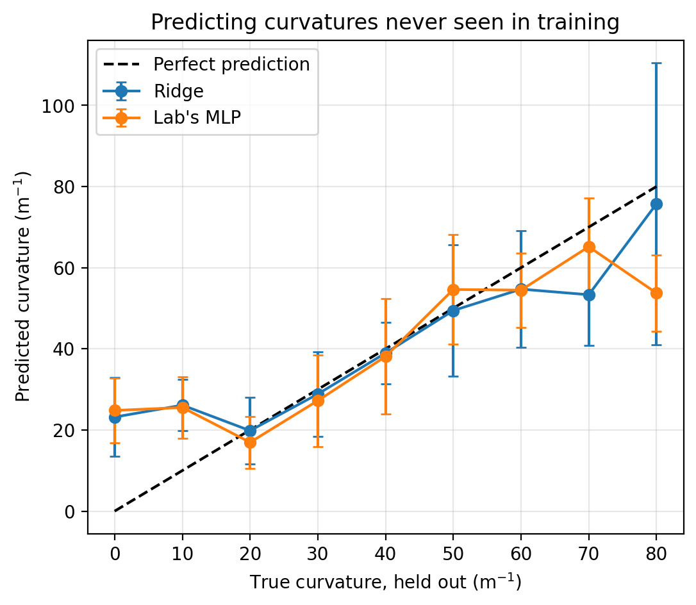
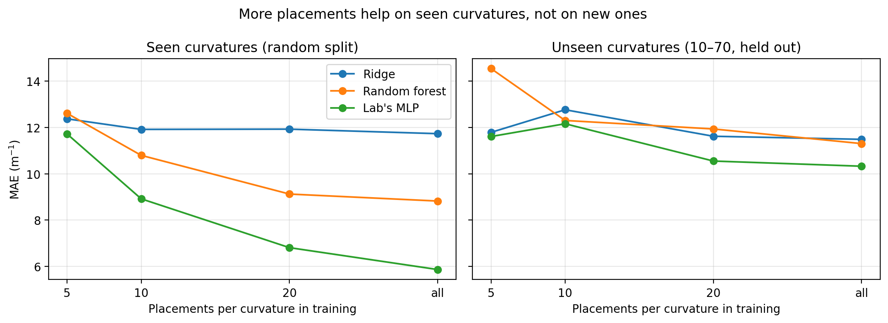

# How Well Does Tactile Curvature Estimation Generalize to New Curvatures?
### A re-analysis of the open-source curvature dataset from the Cornell HAPPI Lab (Haptics Symposium 2026)

The HAPPI Lab released a soft resistive tactile sensor (16 nodes in a 4×4 grid) that estimates
the curvature of the surface it is attached to from its baseline readings, using a residual MLP
trained on cylindrical fixtures from 0 to 80 m⁻¹. Their training code evaluates the model with a
random split stratified by curvature, so every test curvature also appears in training. Real
objects have curvatures between or beyond the training fixtures. This mini-study asks: **how well
does curvature estimation generalize to curvatures never seen in training, which models and
sensing nodes does it need, and does collecting more calibration data help?**

## Data and methods
- Public dataset (`MLPtraining/sensor_data.csv`): 270 samples, 9 curvatures (0–80 m⁻¹ in steps
  of 10) × 30 sensor placements (rotations/flips), 16 node readings each.
- **Two evaluation schemes:** a random 5-fold split stratified by curvature (as in the lab's code),
  and leave-one-curvature-out, where each curvature is held out entirely. "Unseen interior"
  reports held-out curvatures 10–70 only, avoiding extrapolation beyond the training range.
- **Models:** ridge regression, k-nearest neighbors, random forests, and a re-implementation of the
  lab's residual MLP (same architecture, input features, optimizer, mixup, and 500 epochs; trained
  without a validation split and with a single seed).

## Results
| Model | Random split MAE | Unseen MAE | Unseen interior MAE |
|---|---|---|---|
| Ridge (16 raw nodes) | 11.73 | 14.73 | 11.48 |
| Ridge (8 summary features) | 15.17 | 18.77 | 14.50 |
| kNN (summary features) | 11.19 | 17.06 | 13.67 |
| Random forest (raw nodes) | 8.82 | 15.41 | 11.30 |
| Random forest (summary features) | 10.56 | 17.33 | 13.69 |
| Lab's residual MLP | **5.86** | **13.70** | **10.32** |

(MAE in m⁻¹)

**1. A random split overstates generalization to new curvatures.** The lab's MLP was the most
accurate model in every setting, but its error rose from 5.9 to 10.3 m⁻¹ (about 75%) when
curvatures within the training range were held out entirely.

**2. On unseen curvatures, most of the neural network's advantage disappears.** The MLP's error
was about 50% lower than ridge regression on seen curvatures (5.9 vs. 11.7) but only about 10%
lower on unseen interior curvatures (10.3 vs. 11.5).

**3. The sensor seems least sensitive to nearly flat surfaces.** For held-out curvatures of 0, 10,
and 20 m⁻¹, both ridge and the MLP predicted roughly the same value (about 20–26), even though 10
lies inside the training range. Between 20 and 60 m⁻¹, predictions closely tracked the true
curvature; at 70–80, they fell short.

**4. The weakest column of nodes adds little.** Nodes 4, 8, 12, and 16 correlated much less with
curvature (r = 0.16–0.31) than the other twelve nodes (r = 0.51–0.63). Removing them changed
unseen-interior error only slightly (MLP: 10.3 → 10.7; random forest: 11.3 → 11.2), within
run-to-run noise.

**5. More placements help on seen curvatures, not on new ones.** With 5, 10, 20, or all placements
per curvature, the MLP's random-split error fell steadily (11.7 → 8.9 → 6.8 → 5.9), but
unseen-interior error stayed around 10.3–12.8 for every model; ridge with 5 placements (11.8)
matched ridge with all of them (11.5). This suggests that adding more distinct curvature fixtures
(e.g., every 5 m⁻¹) may improve generalization more than repeating placements, a hypothesis these
data support but do not directly test.

**A refuted hypothesis:** because the sensor was rotated and flipped between placements, I expected
rotation-invariant summary features to help. They made every model worse, so node identity still
carries useful information.

## Limitations
- Leave-one-curvature-out leaves a 20 m⁻¹ gap in training around each held-out curvature, a
  stricter test than real objects, which fall closer to training fixtures. A random split is
  optimistic and this test is pessimistic; real performance likely lies in between.
- Single runs with one seed; differences under about 1 m⁻¹ are within noise.
- The MLP re-implementation trains for a fixed 500 epochs without the lab's validation split, so
  its numbers may differ somewhat from the original.
- Cylindrical fixtures only; spherical or irregular surfaces (e.g., the ping-pong ball in the
  lab's validation) were not evaluated here.

## Reproducing
Open `curvature_generalization.ipynb` in Google Colab. The notebook clones the lab's repository
(https://github.com/cornell-happi-lab/HS2026-1D-curvature) to load the data; no data is
redistributed here.
